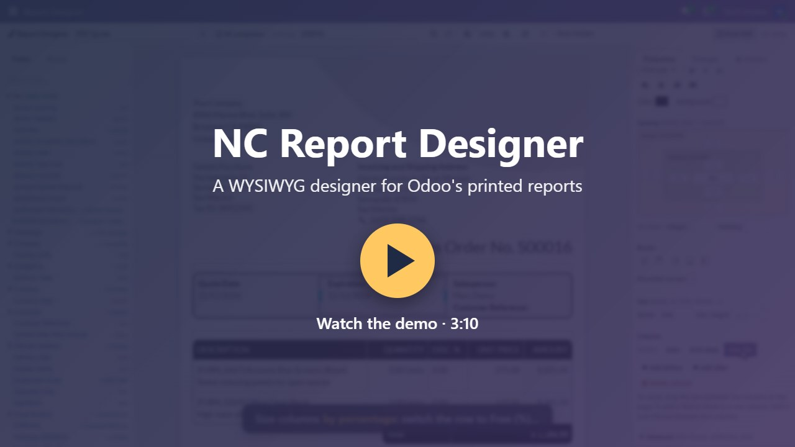
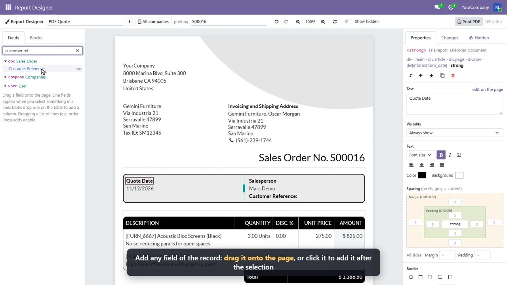
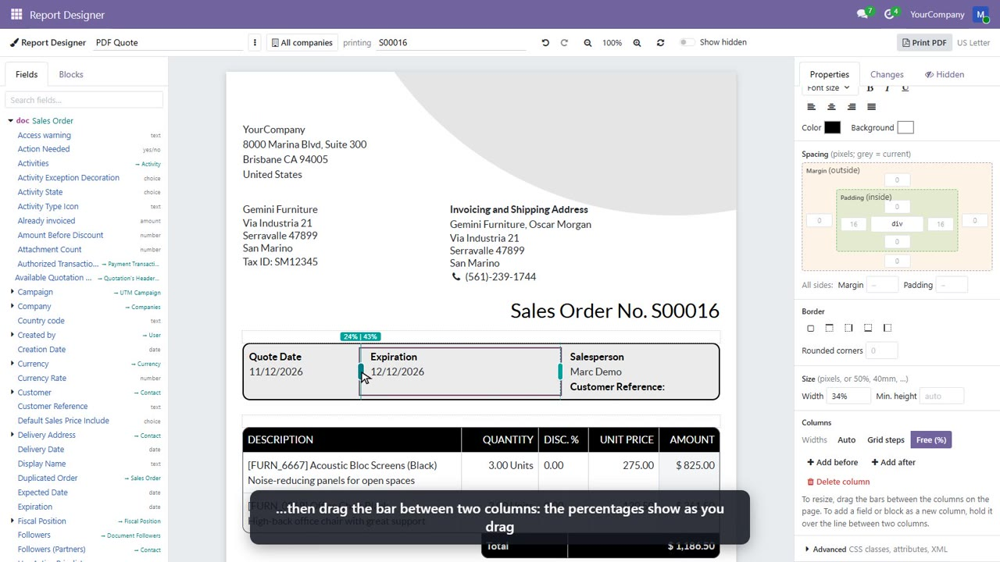
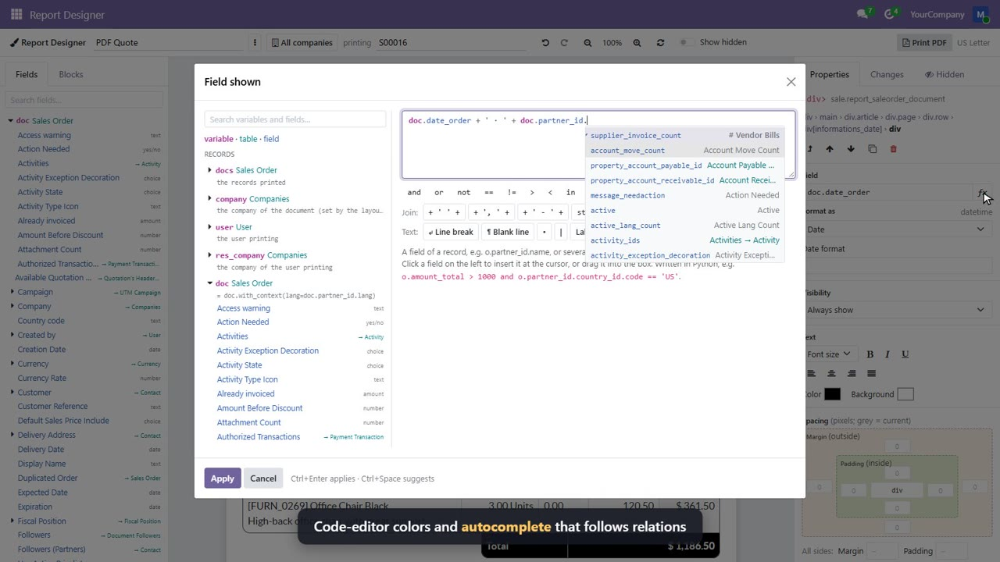
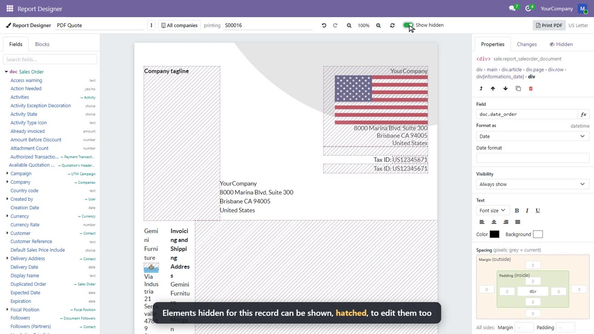
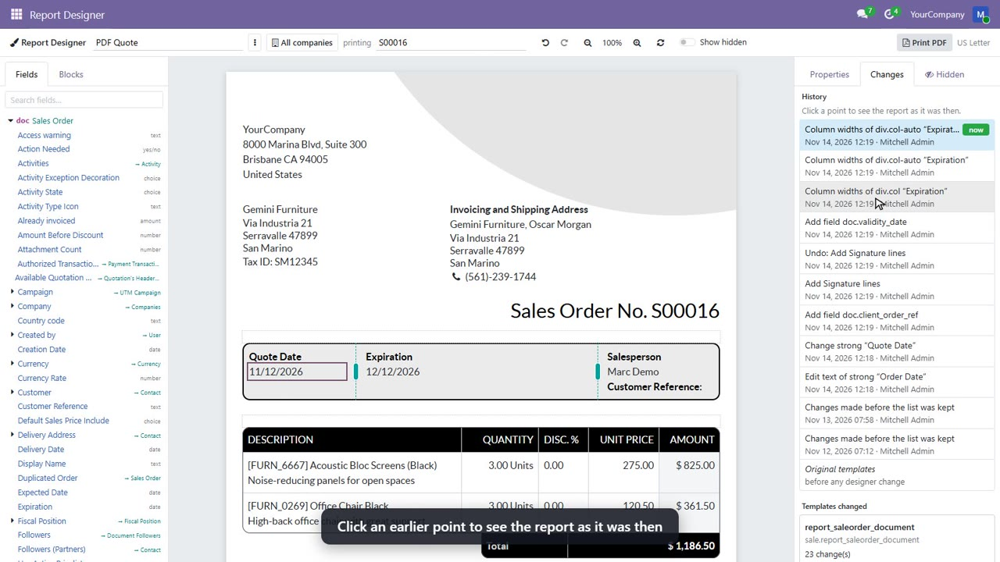
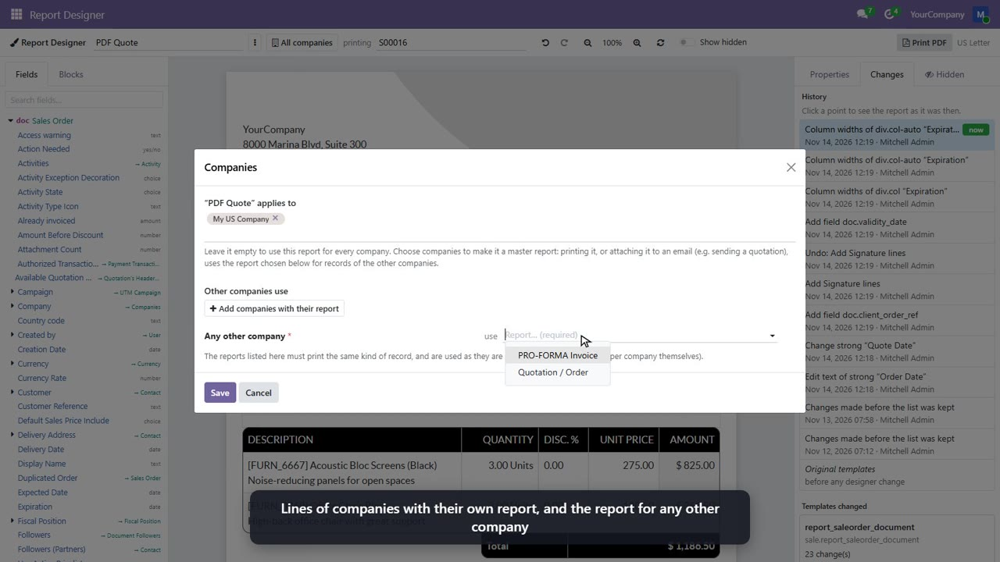

# NC Report Designer for Odoo 19

A WYSIWYG designer for Odoo's printed (QWeb) reports: quotes, invoices, delivery slips and any other PDF report. You edit on a live preview of a real record, and every change is saved as a regular inherited view, so the original templates are never modified and Odoo upgrades keep working.

[](https://nc-automation.github.io/odoo-report-designer/)

▶ **[Watch the demo video](https://nc-automation.github.io/odoo-report-designer/)** (3:10, with captions), or [download it](https://github.com/NC-Automation/odoo-report-designer/raw/main/docs/demo.mp4).

## Features

### Edit on the page
- **Click to select** any element of the report. The properties panel shows its template, its field and how it is computed.
- **Double-click text to edit it** in place.
- **Style** from the properties panel: font size, bold/italic/underline, alignment, colors, margins and padding, borders, rounded corners, width and height.
- **Move, duplicate and delete** elements, with full **undo / redo** (Ctrl+Z / Ctrl+Y).
- **Edit the XML** of any element, its CSS classes and attributes, when you need full control.

### Fields and blocks
- **Drag any field** of the printed record (and fields of related records) onto the page, or click it to add it after the selection. It arrives with its label, already bound to the record.
- **Fields of the lines** (order lines, invoice lines, …) dropped on a table become **new table columns**.
- **Ready-made blocks**: text, headings, two and three columns, boxes, tables, bullet lists, images, the company logo, the print date, signature lines, conditional sections, dividers, spacers and page breaks.
- **Field formats** are picked from the options Odoo really offers for each field (dates, amounts, contacts, …).



### Columns
- **Drop a field or block between two columns** to add it as a new column.
- **Resize columns by dragging** the bars between them. Choose **Free (%)** for any width in percent, **Grid steps** for Bootstrap's 12 steps, or **Auto** for equal widths. The widths show live while you drag.
- Add or delete columns before or after the selected one.



### Expression editor
- Edit the expression behind any field, with **syntax colors** and **autocomplete** that follows relations (`doc.partner_id.country_id.…`).
- See every variable available at that point of the template, and how it is computed.
- Buttons to join several fields, and to add line breaks, separators and labels.



### Hidden elements
- Elements hidden for the previewed record (by a condition) can be **shown hatched** and edited too, and are listed in the **Hidden** tab.
- Edit the **visibility condition** of any element.



### History
- The **Changes** tab lists every change with its date and author.
- **Click an earlier point** to preview the report as it was then, and **go back to it** with one click (itself a listed, undoable change).
- Reset any template to its original.



### Reports per company and emails
- **Master reports:** set the companies a report applies to. Add lines of companies that use another report instead, and the report for any other company. Printing, emails and the portal then pick the right report for each record. A PDF of records from several companies is merged.
- **Edit** a report's name and choose **in which companies' Print menu** it appears.
- **Duplicate** a report to design a variant. The copy gets its own copies of the report's templates, while shared layouts stay shared. Copies can be **deleted** again.
- **Use for emails:** choose the report attached by each email template (for example "Sales: Send Quotation").



## How changes are stored

Each template you change gets one inherited QWeb view (`nc_report_designer.custom_<template key>`), made of `<xpath>` specs. The original templates are never modified: upgrading Odoo or the module that owns a report keeps applying its changes underneath yours. A change can always be undone, or the template reset, from the designer.

## Installation

1. Copy the `nc_report_designer` folder into your Odoo 19 addons path (or add this repository to it).
2. Update the apps list and install **Report Designer**.

It depends only on `web` and `base_setup`, and works on Community and Enterprise, including Odoo.sh.

## Usage

The designer is for administrators (the *Settings* access right). Open it from:
- the **Report Designer** app in the main menu;
- the **Report Designer** button on a report (*Settings › Technical › Reports*);
- *Settings › Companies*, next to *Configure Document Layout*.

Pick a report and a record to preview, then edit on the page. Every change is saved right away.

## Tests

```bash
odoo -d <test database> -i nc_report_designer --test-tags /nc_report_designer --stop-after-init
```

## License

LGPL-3. See [LICENSE](LICENSE).

Made by [NC Automation](https://github.com/NC-Automation).
